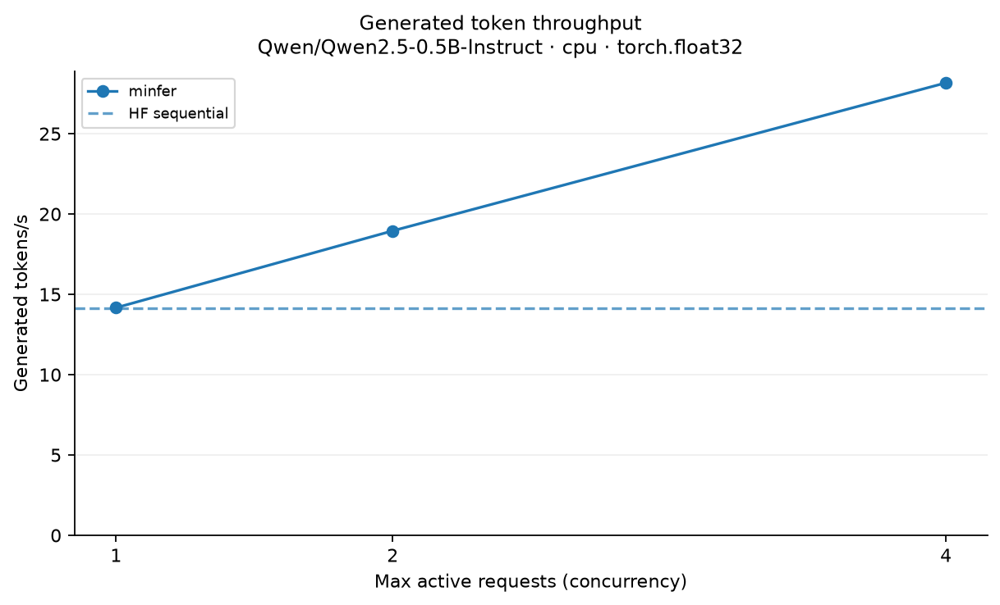

# minfer

An educational engine for local LLM inference on a single device, with manual generation,
continuous batching, token-budget scheduling, and KV memory management. Hugging Face
supplies the Transformer, and minfer runs the generation loop through model forward
passes.

- Batched prompt prefill and ragged continuous decode batching
- Deterministic FIFO admission with request, per-step token, and KV capacity limits
- Dynamic caches or fixed-size paged KV storage with inspectable block tables and metrics
- CPU and Apple MPS validation, with a CUDA device path
- Greedy / temperature / top-k / top-p sampling and streaming events
- Correctness oracles, reproducible benchmarks, and JSON-driven charts and reports

## CPU quickstart

Requires Python 3.11–3.13 and [uv](https://docs.astral.sh/uv/).

```bash
git clone https://github.com/harshb16/minfer.git
cd minfer
uv sync --locked
uv run minfer generate --device cpu --prompt "Say hello." --max-new-tokens 8
```

The first run downloads **Qwen/Qwen2.5-0.5B-Instruct** from Hugging Face. The CLI
applies the instruction chat template by default. Use `--raw-prompt` to disable it.
Repeat `--prompt` to generate for multiple prompts in one call.

Run the same engine from Python with `uv run python`.

```python
from minfer import LLMEngine, SamplingParams

engine = LLMEngine(device="cpu")
prompts = ["Say hello.", "Name a primary color."]
results = engine.generate_batch(prompts, SamplingParams(max_new_tokens=8))
for result in results:
    print(result.text)
```

## Representative benchmark

The 2026-10-02 benchmark ran Qwen2.5-0.5B-Instruct in float32 on an arm64 Mac CPU.
It used four prompts (38, 45, 75, and 59 tokens), up to eight greedy output tokens
per prompt, one warmup, and a dynamic cache. With four active requests, minfer
generated 28.16 tokens/s versus 14.12 for sequential Hugging Face generation.
All output token IDs matched the reference. Timing includes queueing and tokenization
and excludes model loading. [CPU benchmark report](benchmarks/reports/cpu-budget-dynamic/report.md) ·
[Raw JSON](benchmarks/results/cpu-budget-dynamic.json) ·
[Paged-mode report](benchmarks/reports/cpu-budget-paged/report.md) ·
[Historical MPS results](benchmarks/results/mps-historical.json)



## Architecture

```text
Prompts
  |
  v
FIFO admission <-----------------------------------------------+
  |                                                            |
  v                                                            |
Batched prefill / ragged decode <--> Dynamic cache / KV blocks |
  |                                                            |
  v                                                            |
Hugging Face model forward                                     |
  |                                                            |
  v                                                            |
Sample, stream, and finish ------------------------------------+
```

Each step reserves decode work first, then admits whole FIFO prompts from the remaining
token budget. Newly admitted requests emit their first token and start decoding on a
later step. Every request emits at most one token per step. Completion releases its
cache or block ownership immediately. Admission conservatively reserves worst-case
output growth, preventing KV exhaustion without preemption.

`generate_batch()` validates every prompt before queueing the batch. A successful
call drains outstanding work and returns the new results in prompt order.

Paged mode stores each request's KV history in fixed-size blocks from a shared pool.
It materializes a contiguous DynamicCache for standard Hugging Face attention, then
copies new KV entries back into the pool. This adds memory and copy overhead.

[Architecture and scheduler](docs/architecture.md) · [Paged KV storage](docs/paged-kv.md) ·
[Benchmark methodology and plotting](docs/benchmarks.md)

## Validate and benchmark

```bash
uv run pytest
uv run ruff check .
uv run ruff format --check .
uv build
uv run python -m benchmarks.benchmark --device cpu --requests 4 \
  --concurrency 1 2 4 --max-new-tokens 8 --cache-mode paged \
  --output benchmarks/results/example.json
uv run python -m benchmarks.plot benchmarks/results/example.json \
  --output-dir benchmarks/reports/example
```

The push workflow runs the fast CPU suite with a tiny Hugging Face Qwen model and
synthetic caches. Run `uv run pytest -m integration` to opt into canonical checkpoint
tests. The recorded validation covers logits, caches, and greedy token parity on
CPU float32 and Apple MPS float16. The CUDA device path is unverified.
[Validation record](docs/validation.md)

## Limitations

Token budgets account for logical KV slots. Device memory also includes the backing
pool, padding, and transient allocations. Reservations can underuse capacity, and
a blocked FIFO head prevents later prompts from overtaking.
Only Qwen2.5-0.5B-Instruct is verified. No custom kernels, chunked prefill, preemption,
prefix caching, speculative decoding, distributed inference, quantization, or HTTP serving.
